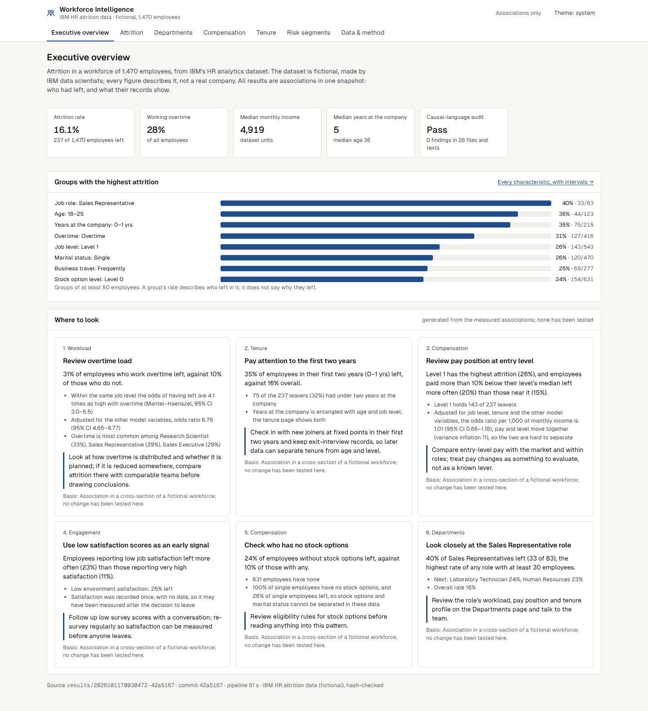
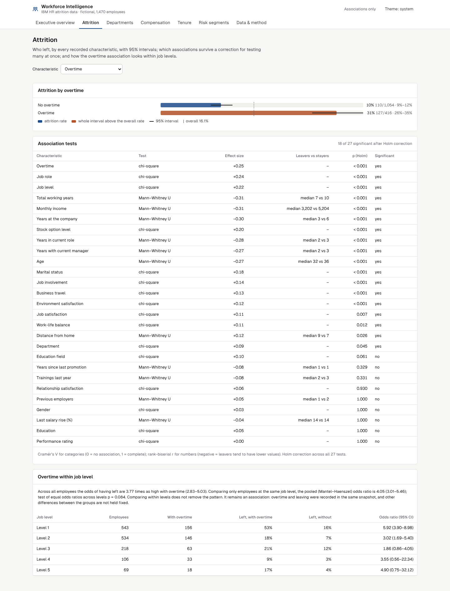
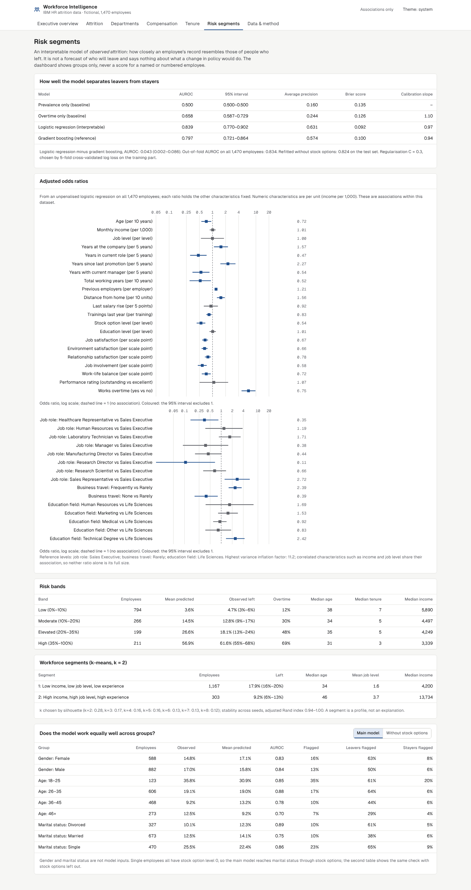
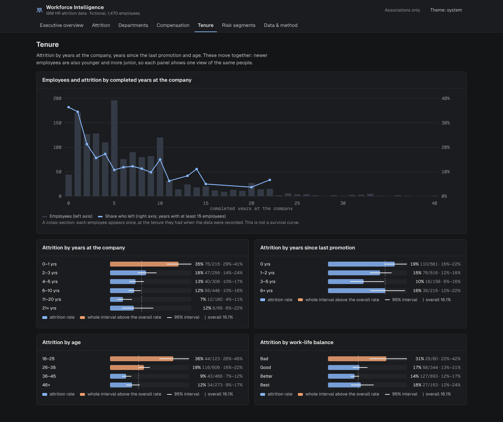
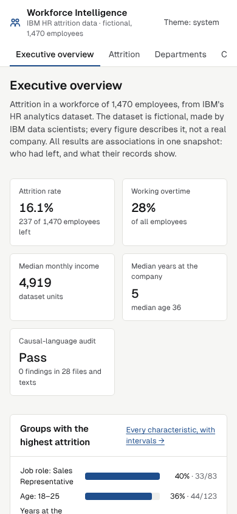

# Workforce attrition intelligence

Finds which employee characteristics are *associated* with attrition, and says no more than that.
Employee records go through a SQL data model and data checks, then descriptive rates with
intervals, association tests, stratification, segmentation and an interpretable model of observed
attrition, into a BI dashboard and a report. An automated audit fails the build if any document,
dashboard text or generated recommendation uses causal wording.

> **The data are fictional.** IBM's HR Analytics Employee Attrition & Performance dataset was
> created by IBM data scientists (ODbL/DbCL). Every number describes that synthetic workforce,
> not a real company, and every result is an association in a single snapshot.



## Results

From `results/20261011T003047Z-42a5167` (clean commit `42a5167`, 51 s). Full tables:
[docs/generated/results.md](docs/generated/results.md); write-up: [docs/REPORT.md](docs/REPORT.md).

- **237 of 1,470 employees left (16.1%).**
- **Overtime**: 30.5% left with overtime against 10.4% without. Within job levels the pooled odds
  ratio is 4.05 (95% CI 3.01–5.46); holding every model characteristic fixed, 6.75 (4.66–9.77).
- **Level, pay, tenure, age**: job level 1 26.3%; lowest income quintile 31.3%; first two years
  34.9%; age 18–25 35.8%. Income's adjusted odds ratio is 1.01 per 1,000 (0.86–1.18): pay and job
  level are too closely related (VIF ≈ 11) to separate.
- **Roles**: Sales Representatives 39.8% (29.9–50.5%), Research Directors 2.5%. Departments
  differ less (13.8–20.6%).
- **Performance rating** shows no association (16.1% vs 16.4%). 18 of 27 tests are significant
  after Holm correction.
- **Model**: logistic regression, test AUROC 0.839 (0.770–0.902), calibration slope 0.97; better
  than overtime alone (0.658) and an untuned gradient-boosting reference (0.797; difference +0.043,
  0.002–0.086). Out-of-fold AUROC 0.834. The high-risk band (≥ 35%) holds 130 of 237 leavers.
- **Fairness**: similar ranking quality for women and men (AUROC 0.83 / 0.84); weaker for
  employees aged 46+ (0.70) and married employees (0.75). All single employees have no stock
  options, so stock options stand in for marital status; a refit without them is reported too.
- **Causal-language audit**: pass, 0 findings.

Hypotheses were written before the analysis ([docs/PLAN.md](docs/PLAN.md)); H2–H4 are supported,
H1 (Sales highest) only weakly.

## What is built

- **SQL layer** (`sql/`, DuckDB): staging with decoded labels → 12 data checks → star model
  (`fact_employee`, department, role and level dimensions) → one SQL file per measure.
- **Statistics and model** (`src/wfintel`): Wilson intervals; chi-square and Mann–Whitney with
  Holm correction; Mantel–Haenszel stratification; k-means; logistic regression with
  cross-validated regularisation, baselines, a boosting reference, bootstrap intervals, adjusted
  odds ratios and VIFs; out-of-fold risk bands; fairness tables; six evidence-based
  recommendations.
- **Causal-language audit** (`wfintel audit`): 17 rules over README, docs, Power BI notes,
  dashboard source and each run's recommendations; CI fails on any finding.
- **Dashboard** (`web/`, React + TypeScript): Executive overview, Attrition, Departments,
  Compensation, Tenure, Risk segments, Data & method. Groups only, never an individual's score.
  Light and dark themes, keyboard accessible, no axe-core WCAG 2.1 AA violations.
- **API** (`wfintel serve`): read-only, rate limited, token-guarded beyond loopback.
- **Power BI: pending.** Power BI Desktop cannot run in this environment. The model is exported to
  Parquet and the relationships and DAX measures are written ([powerbi/](powerbi/README.md)), but
  no `.pbix` has been built and no Power BI screenshots exist.

## Quick start

```bash
make setup          # uv + npm dependencies
make all            # THE one command: hash-check the data, SQL + statistics + model, report, audit
make serve          # dashboard on http://127.0.0.1:8014
make test lint      # SQL, statistics, model, audit and API tests; ruff, mypy strict, ESLint, tsc
make test-ui        # browser and accessibility tests (Chromium)
```

`make smoke` runs the pipeline into `results/scratch` without touching the committed result
(what CI runs). Unit tests use 800 synthetic employees with planted data issues.

## Screenshots

| | |
|---|---|
|  |  |
|  |  |

## Documentation

[PLAN](docs/PLAN.md) (before the analysis) · [DESIGN](docs/DESIGN.md) ·
[DATASET](docs/DATASET.md) · [METRICS](docs/METRICS.md) · [DECISIONS](docs/DECISIONS.md) ·
[REPORT](docs/REPORT.md) · [REVIEW](docs/REVIEW.md) · [Power BI](powerbi/README.md)

## Licence

Code: MIT ([LICENSE](LICENSE)). Data: IBM HR Analytics Employee Attrition & Performance, ODbL
(database) / DbCL (contents), fictional.
